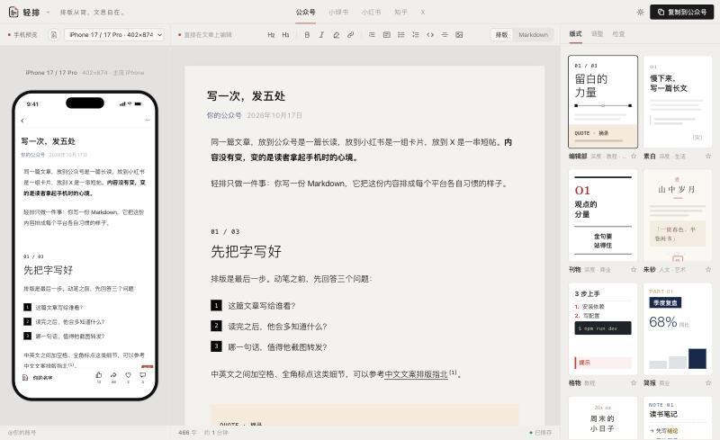
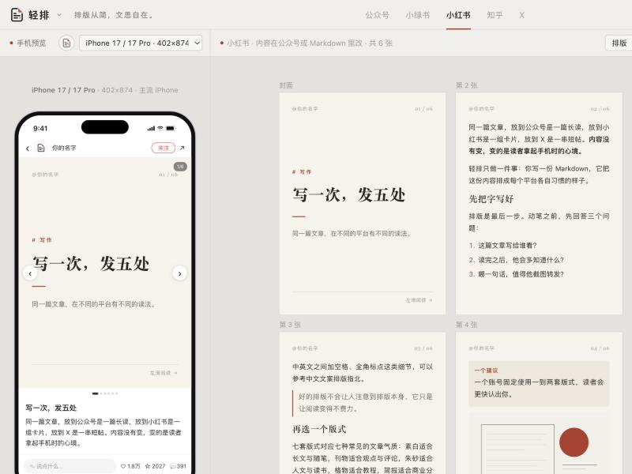
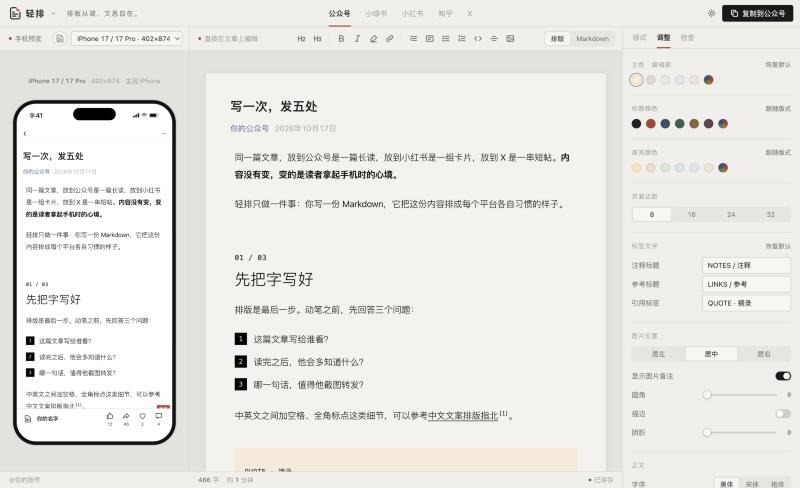

# 轻排 Qingpai

> 排版从简，文思自在。

**一份 Markdown，排成公众号、小绿书、小红书、知乎、X 各自习惯的样子。**

轻排是一个**纯本地、单文件**的网页排版工具：把 Markdown（或从网页、Obsidian 粘贴来的文章）排成带内联样式的版式，一键复制到微信公众号后台，样式不丢；同时用真机比例预览它在手机上的样子，并把同一篇内容拆成小红书 / 小绿书卡片、知乎正文、X 串推。

它解决的问题：写作者在 Obsidian 等地方写好文章后，到公众号后台还要重新排版，换一个平台又要重来一遍，而且很难提前知道在手机上会不会溢出、首屏看到多少。



| 小红书卡片 | 调整面板 |
|---|---|
|  |  |

## 能做什么

- **画布即编辑**：中间直接在排好版的文章上改字，Markdown 源码视图可随时切换，两边实时同步。
- **12 套版式**：编辑部、素白、刊物、朱砂、格物、简报、手记等，主色、标题色、高亮色、字号、行距、页面边距、图片圆角 / 阴影 / 描边都可调。
- **手机预览**：iPhone 17 Pro Max / iPhone 17 / 安卓 360 宽三种机型，标出首屏线，检测哪段会超出屏幕（对应公众号后台的「存在溢出问题」）。
- **多平台**：公众号、小绿书、小红书（3:4 卡片导出 PNG）、知乎（可编辑画布 / 导出 .md）、X（串推 / 长帖 / 文章）。
- **Obsidian 友好**：支持 `![[图片.png|245]]`、`[[双链]]`、`==高亮==`、`> [!tip]` 提示框、脚注、frontmatter；本地图片可关联附件文件夹（Chrome / Edge 会记住文件夹）。
- **发布前检查**：标题长度、错别字和标点、外链转文末注释、溢出提醒等，全部在本机按规则计算，不调用任何 AI 或网络服务。
- **全部本地**：文章和图片只存在你自己浏览器的本地存储里，不上传任何服务器。

## 在线使用

打开即用：<https://xiaoniudaodao.github.io/qingpai-wechat-formatter/>（GitHub Pages，纯静态页面，文章只保存在你自己的浏览器里）

## 本地运行

不需要安装任何东西，**直接双击 `index.html` 用浏览器打开即可**（推荐 Chrome / Edge）。

如果要用本地服务器打开（部分浏览器在 `file://` 下不允许本地存储）：

```bash
git clone https://github.com/xiaoniudaodao/qingpai-wechat-formatter.git
cd qingpai-wechat-formatter
python3 -m http.server 8000
```

然后在浏览器打开 <http://localhost:8000/>。

## 修改源码与构建

源码在 `src/`，`index.html` 是由 `build.mjs` 把所有源码、样式和第三方库打包成的单文件。改完源码需要重新构建（需要 Node.js 18+，不需要 `npm install`）：

```bash
node build.mjs                         # 生成 index.html
for f in tests/*.mjs; do node "$f"; done   # 运行测试
```

```
src/
  index.html    页面骨架        styles.css   样式
  app.js        界面与交互      canvas.js    画布编辑、转回 Markdown
  render.js     版式套用与导出   templates.js / scenes.js  版式定义
  core.js       解析、检查、图片语法   cards.js  小红书 / 小绿书卡片
  editor.js     Markdown 源码视图    sample.js  示例文稿
vendor/         marked、CodeMirror 6（已打包，MIT）
tests/          node:test 单元测试
```

## 技术栈

- 原生 HTML / CSS / JavaScript，无框架，无后端
- [marked](https://github.com/markedjs/marked) 12.0.2：Markdown 解析（MIT）
- [CodeMirror 6](https://codemirror.net/)：源码编辑器，已用 esbuild 打包进 `vendor/codemirror.bundle.js`（MIT，打包配置见 `vendor/codemirror-build/`）
- 浏览器 API：contenteditable、IndexedDB、File System Access API（记住图片文件夹）、Clipboard API
- 构建与测试只用 Node.js 自带能力（`node:fs`、`node:test`）

## 已知限制

- **不需要后端**，但需要现代浏览器；推荐 Chrome / Edge。Safari / Firefox 可用，但「记住图片文件夹」不支持，每次需重新选择。
- 从 Obsidian 复制的文章里，本地图片只有文件名，需要点一下缺图占位框选择图片所在文件夹（浏览器安全限制，网页不能自行读取本地文件）。
- 粘贴到公众号后台时，嵌入的本地图片是否被自动转存因账号而异；图片阴影等样式是否保留以公众号编辑器为准。
- 画布编辑基于浏览器的 contenteditable，复杂结构（嵌套列表、表格内编辑）体验不如专业富文本编辑器，可切到 Markdown 视图修改。
- 文章和图片保存在当前浏览器的本地存储中，换浏览器或清除网站数据后不会保留，请自行保存 Markdown 源稿。
- 平台规则（字数、图片数等）整理于 2026 年 10 月，平台可能调整。

## 开源协议

[MIT](LICENSE)。第三方库的许可证见 `vendor/marked-LICENSE.md`、`vendor/codemirror-LICENSE.md`。
